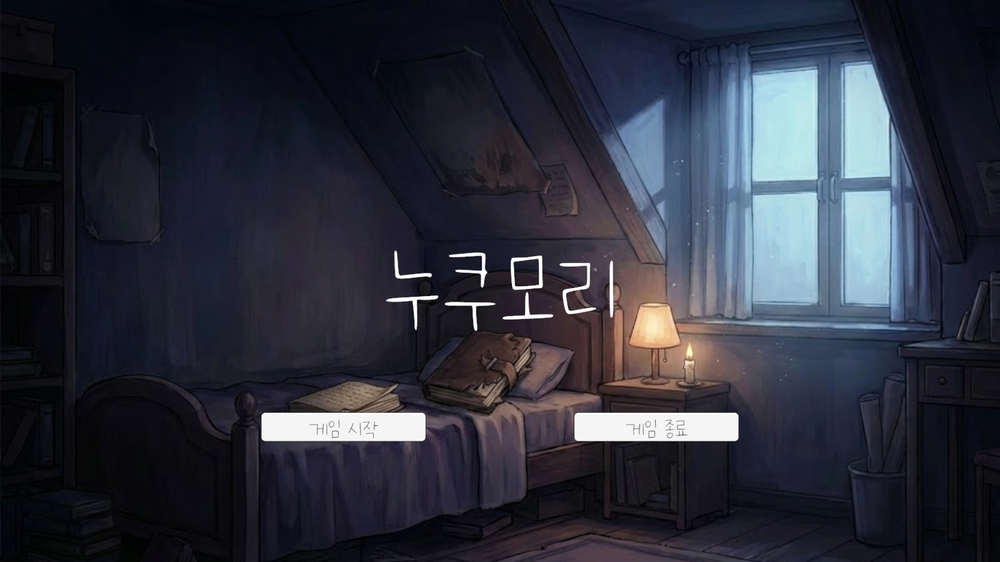
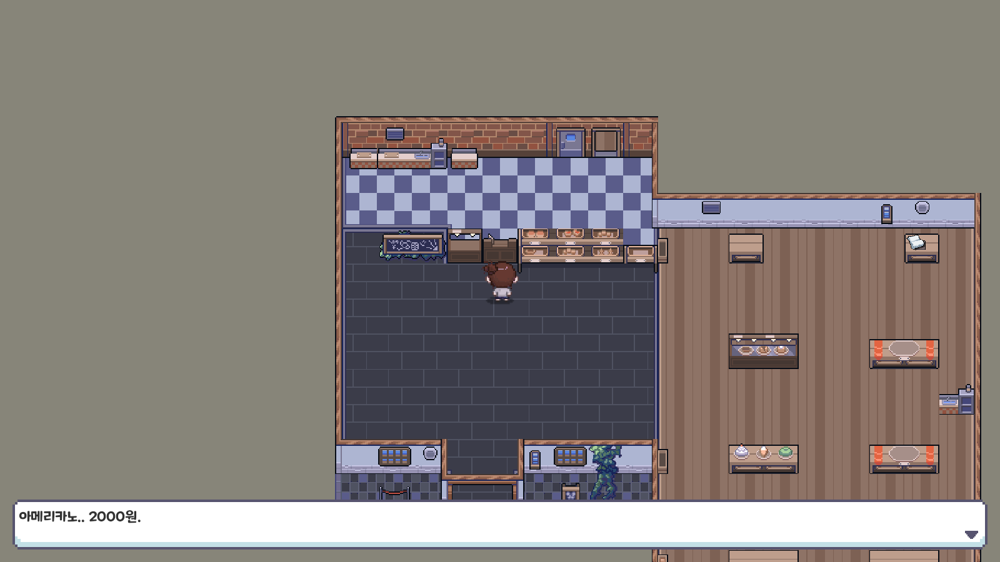
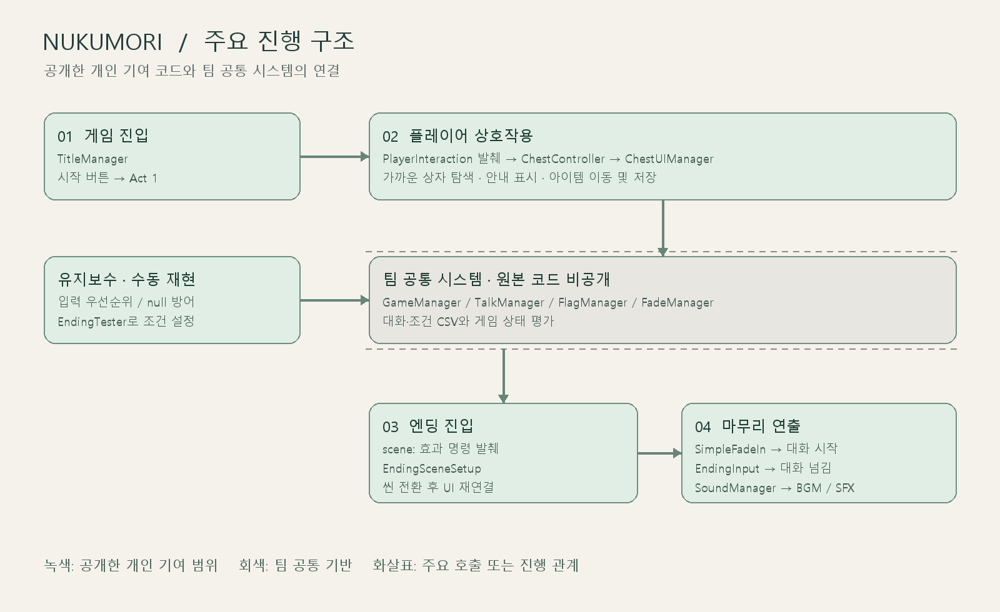

# Nukumori

Unity 기반 감성 퍼즐 어드벤처 팀 프로젝트

## 프로젝트 개요

플레이어가 감정을 상징하는 공간을 탐험하며 퍼즐과 상호작용으로 이야기를 진행하는 게임입니다.

## 개발 기간

2025.03 ~ 2025.12

공개 코드에는 2026.05.07 개인 개선 커밋까지 반영되어 있습니다. 팀 개발 기간과 이후 유지보수 작업은 [기여 내역](Docs/contribution.md)에서 구분했습니다.

## 개발 인원

4인 팀 프로젝트

## 내 역할

- 플레이어 상호작용 기능 구현
- 버그 테스트 및 기능 유지보수
- 프로젝트 후반 시작 화면, 게임 진입 흐름, 주요 진행 구조 정리
- 엔딩 분기/조건, 종결 사운드, 마무리 연출 구현
- 최종 기능 통합 및 전체 플레이 테스트

추가로 Git 이력에서 확인한 기여는 카메라 이동 이벤트, 선택지 독립 키 입력, 초기 달리기·스태미나 구현입니다. 팀 개발 이후에는 일기 조각 조합과 분노방 연타 퍼즐을 추가했습니다.

## 공개 범위

본 저장소는 포트폴리오 제출용 저장소이며, 직접 작성한 코드 및 설명 자료 중심으로 구성했습니다.

팀 프로젝트 전체와 개인 기여를 구분해 검토할 수 있도록 별도 저장소로 정리했습니다. Git 작성 이력상 `dev_slime`의 기여를 확인한 파일을 선별했으며, 공동 수정 파일은 본인이 작성한 부분만 `*.Excerpt.cs`로 발췌했습니다. 발췌본의 원본 위치·줄 범위·커밋은 [소스 목록](Docs/source-manifest.json)에 기록했습니다.

게임 전체를 실행할 수 있는 Unity 프로젝트는 아닙니다. 씬, 프리팹, 대사 CSV, 외부 에셋과 팀 공통 코드는 포함하지 않았습니다. 스크린샷은 팀 게임의 결과 화면이며 그래픽 전체를 개인 제작물로 주장하지 않습니다.

## 주요 코드 예시

| 구분 | 주요 코드 | 구현 내용 |
| --- | --- | --- |
| 플레이어 상호작용 | [PlayerInteraction.Excerpt.cs](Scripts/PlayerInteraction/PlayerInteraction.Excerpt.cs) | 주변 상자 탐색, 가까운 상자 선택, 상호작용 안내 표시 |
| 상자·아이템 | [ChestController.cs](Scripts/PlayerInteraction/ChestController.cs) | 상자 초기화, 아이템 생성·이동, 저장 데이터 처리 |
| 게임 진입 흐름 | [TitleManager.cs](Scripts/Flow/TitleManager.cs) | 시작 버튼에서 Act 1 로드, 종료 버튼 처리 |
| 엔딩 분기 연결 | [FlagManager.SceneCommand.Excerpt.cs](Scripts/Ending/FlagManager.SceneCommand.Excerpt.cs) | 효과 문자열의 `scene:` 명령을 해석해 엔딩 씬으로 전환 |
| 엔딩 초기화 | [EndingSceneSetup.cs](Scripts/Ending/EndingSceneSetup.cs) | 이전 Canvas 정리, 엔딩 UI·TalkManager 재연결 |
| 마무리 연출 | [SimpleFadeIn.cs](Scripts/Ending/SimpleFadeIn.cs), [EndingInput.cs](Scripts/Ending/EndingInput.cs) | 페이드 종료 후 대화 시작, 엔딩 전용 대화 입력 |
| 사운드 | [SoundManager.cs](Scripts/Ending/SoundManager.cs), [효과 명령 발췌](Scripts/Ending/GameManager.SoundEffects.Excerpt.cs) | BGM·SFX 재생 및 BGM 정지 명령 |
| 기능 수정·유지보수 | [ChestInputPriority.Excerpt.cs](Scripts/BugFixes/ChestInputPriority.Excerpt.cs), [EndingTester.cs](Scripts/BugFixes/EndingTester.cs) | 상자 입력 우선 처리, 엔딩 조건 수동 재현 |
| 카메라·이벤트 진행 | [EventManager.Excerpt.cs](Scripts/Flow/EventManager.Excerpt.cs), [EventData.Excerpt.cs](Scripts/Flow/EventData.Excerpt.cs) | 카메라 이동·대기·복귀, 대화와 씬 전환 연결 |
| 이벤트 조건 연결 | [TriggerController.Excerpt.cs](Scripts/Flow/TriggerController.Excerpt.cs) | 조건 검사와 이벤트 트리거 보완 |
| 선택지 키 입력 | [ChoicePanelUI.Excerpt.cs](Scripts/Ending/ChoicePanelUI.Excerpt.cs) | 플레이어 매니저 연결 없이 선택 이동·확정 키 처리 |
| 일기 조합 퍼즐 | [DiaryFragmentCombiner.cs](Scripts/Puzzle/DiaryFragmentCombiner.cs) | 인벤토리의 조각 확인, 완성 아이템·플래그·효과음 처리 (2026.05) |
| 분노방 퍼즐 | [RageInputCounter.cs](Scripts/Puzzle/RageInputCounter.cs) | 제한 시간 내 연타 수, 진행 UI, 완료 이벤트 처리 (2026.05) |
| 초기 구현·실험 | [Historical 안내](Scripts/Historical/README.md) | 달리기·스태미나 초기 구현과 별도 브랜치 컷신 실험 |

[기여 내역 및 버그 수정 사례](Docs/contribution.md) · [코드 읽기 안내](Docs/code-guide.md) · [화면 자료](Docs/screenshots/README.md)

2026.09.07에 전체 브랜치의 작성자 일치 기록 29개를 재점검해 누락 자료 14개를 추가했습니다. 현재 공개 코드 자료는 원본·발췌를 합쳐 37개입니다. [커밋별 확인 및 반영 결과](Docs/commit-audit.md)에서 코드 외 씬·CSV 설정 기여도 확인할 수 있습니다.

## 게임 화면

타이틀과 Act 1의 실제 실행 장면입니다. 캡처 환경과 표시 범위는 [화면 자료](Docs/screenshots/README.md)에 기록했습니다.

## 주요 구조

화살표는 주요 호출 또는 진행 관계를 나타냅니다. 점선 영역은 공개하지 않은 팀 공통 시스템입니다.

## 사용 기술

C#, Unity · Unity UI · Physics2D · Coroutine · PlayerPrefs

원본 프로젝트에 기록된 Unity 버전: `6000.0.49f1`
