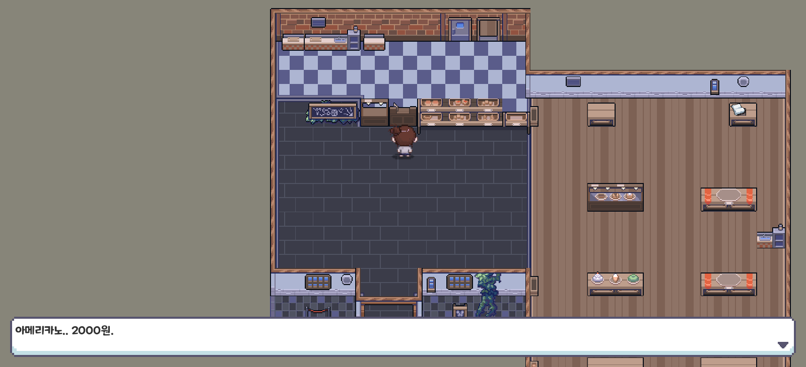

# Nukumori (누쿠모리) — 개인 기여 코드 포트폴리오

감정을 상징하는 공간을 탐험하며 퍼즐과 대화로 이야기를 진행하는 **Unity 2D 감성 퍼즐 어드벤처**입니다.
게임 개발 창업 동아리의 **4인 팀 프로젝트**였고, 이 저장소에는 그중 **제가 직접 작성한 코드만** 골라 담았습니다.


| | |
| --- | --- |
| 기간 | 2025.03 ~ 2025.12 (팀 개발) · 2026.05 개인 추가 작업 |
| 팀 | 4인. 그래픽·스토리·사운드 리소스는 팀 작업 또는 사용 에셋의 결과물입니다 |
| 담당 | 플레이어 상호작용(상자·인벤토리), 엔딩 진입·연출, 타이틀 진입, 버그 수정, 최종 통합 테스트 |
| 기술 | C# · Unity `6000.0.49f1` · Unity UI · Physics2D · Cinemachine · Coroutine · PlayerPrefs |

> 이 저장소만으로는 빌드되지 않습니다. 씬·프리팹·대사 CSV·팀 공통 코드(GameManager, TalkManager, FlagManager 등)는 포함하지 않았습니다.
> 원본 기준 커밋: `ForSUNYA/Nukumori@608c01a` · 선별 방법은 [아래](#공개-범위와-근거) 참고

## 내가 한 일 / 팀이 한 일

| 내가 구현·수정 | 팀 공통 기반 (비공개, 사용만 함) |
| --- | --- |
| 상자 탐지·열기, 상자↔인벤토리 아이템 이동과 저장 | GameManager · TalkManager 대화 시스템 |
| 엔딩 분기 결과를 씬 전환으로 잇는 `scene:` 명령 | FlagManager 조건 평가기, 이벤트 시퀀스 구조 |
| 엔딩 씬 진입 시 UI·매니저 재연결, 페이드 후 대화, 엔딩 전용 입력, BGM/SFX | FadeManager, 대사·조건 CSV 원문 |
| 카메라 이동 이벤트(이동 → 대기 → 플레이어 복귀) | 맵·캐릭터 그래픽, 스토리, 사운드 리소스 |
| 타이틀 → Act 1 진입, 입력 충돌 등 버그 수정, 엔딩 조건 재현 도구 | |

## 게임 화면



Act 1 실제 실행 화면입니다. 위쪽 빈 배경만 잘라냈고 게임 화면 자체는 수정하지 않았습니다. ([원본 1600×900 캡처](Docs/screenshots/02-act1.png) · [캡처 환경](Docs/screenshots/README.md))

## 대표 코드 (면접에서 바로 열어볼 곳)

### 1. 상자·인벤토리와 저장 — 팀 기간
- [`ChestController.cs#L20-L66`](Scripts/PlayerInteraction/ChestController.cs#L20-L66) 상자 초기화: 저장 키 확인 후 로드 / 신규 생성 분기
- [`ChestController.cs#L88-L149`](Scripts/PlayerInteraction/ChestController.cs#L88-L149) 아이템별 확률 판정 후 빈 슬롯 중 무작위 배치
- [`ChestController.cs#L171-L220`](Scripts/PlayerInteraction/ChestController.cs#L171-L220) 슬롯 단위 PlayerPrefs 저장·로드
- [`PlayerInteraction.Excerpt.cs#L28-L55`](Scripts/PlayerInteraction/PlayerInteraction.Excerpt.cs#L28-L55) `OverlapCircleAll`로 가장 가까운 상자 선택
- 이 코드에서 직접 찾은 버그는 [아래](#포트폴리오-정리-중-발견한-버그)에 정리했습니다.

### 2. 엔딩 씬 전환과 UI 재연결 — 팀 기간
- [`FlagManager.SceneCommand.Excerpt.cs#L9-L30`](Scripts/Ending/FlagManager.SceneCommand.Excerpt.cs#L9-L30) 대사 데이터의 효과 문자열 `scene:씬이름`을 해석해 씬 전환. `key=value` 분리보다 **먼저** 검사해야 하는 순서 문제를 해결했고, FadeManager가 없으면 `SceneManager.LoadScene`으로 대체합니다.
- [`EndingSceneSetup.cs#L15-L51`](Scripts/Ending/EndingSceneSetup.cs#L15-L51) 씬 로드 후 한 프레임 대기 → Act 5에서 넘어온 Canvas 제거 → 씬 간 유지되는 GameManager에 엔딩 씬의 TalkManager·UI를 다시 연결. 엔딩 진입 후 UI가 겹치고 대화가 멈추던 문제를 해결한 코드입니다.

### 3. 카메라 이동 이벤트 (Coroutine + Cinemachine) — 팀 기간
- [`EventManager.Excerpt.cs#L94-L143`](Scripts/Flow/EventManager.Excerpt.cs#L94-L143) 임시 추적 대상을 만들어 `vcam.Follow`를 넘기고, 거리 기준 일정 속도로 이동 → 대기 → 플레이어 위치로 복귀
- [`#L160-L166`](Scripts/Flow/EventManager.Excerpt.cs#L160-L166) 임시 대상 정리, [`#L71-L77`](Scripts/Flow/EventManager.Excerpt.cs#L71-L77) 씬 로드 콜백을 명명된 로컬 함수로 만들어 구독 해제 보장

### 4. 입력 우선순위 버그 수정 — 팀 기간
- [`ChestInputPriority.Excerpt.cs#L10-L15`](Scripts/BugFixes/ChestInputPriority.Excerpt.cs#L10-L15)
- **문제:** 상자 근처에서 상호작용 키(E)를 눌러도 상자가 열리지 않고 대화가 먼저 실행됨
- **원인:** 대화와 상자 열기가 같은 키를 쓰는데, 처리 순서상 대화 분기가 먼저 입력을 소비
- **수정:** 처리 순서를 추적해 상자 대상이 있으면 상자 열기를 먼저 실행하고 `return` 하도록 변경 (원본 커밋 `d2998ba`)

### 5. 분노방 연타 퍼즐 — 팀 이후 개인 추가 (2026.05)
- [`RageInputCounter.cs#L59-L140`](Scripts/Puzzle/RageInputCounter.cs#L59-L140) 첫 입력부터 제한 시간을 재는 연타 카운트, 진행도에 따른 오브젝트 비활성화, 완료 시 플래그·이벤트 호출
- 같은 시기 추가: [`DiaryFragmentCombiner.cs`](Scripts/Puzzle/DiaryFragmentCombiner.cs) 일기 조각 조합

## 포트폴리오 정리 중 발견한 버그

> 2026-10-13 이 저장소를 다시 정리하며 제 코드를 읽다가 발견했습니다. 원본 게임과 이 저장소의 코드는 **수정하지 않았고**(공개 파일은 원본 해시와 일치하도록 유지), 원인과 수정안만 기록합니다.

**증상:** 상자를 열어 아이템을 전부 꺼낸 뒤 씬을 다시 불러오면, 같은 상자에 아이템이 새로 생성됩니다. (아이템 무한 획득)

**원인:** "열린 적 있음"과 "내용물이 비었음"을 같은 상태로 취급합니다.
1. 슬롯을 비우면 [`ChestSlotUI.cs#L163-L169`](Scripts/PlayerInteraction/ChestSlotUI.cs#L163-L169)에서 `SaveChestData()` 호출
2. 빈 슬롯은 저장 키를 삭제합니다 → [`ChestController.cs#L183-L187`](Scripts/PlayerInteraction/ChestController.cs#L183-L187). 모두 비우면 `_opened` 키만 남습니다.
3. 다음 로드 때 슬롯 키가 하나도 없으면 `hasValidSlotData == false` → [`ChestController.cs#L37-L51`](Scripts/PlayerInteraction/ChestController.cs#L37-L51)에서 `isFirstOpen = true`가 되어 `GenerateInitialItems()`가 다시 실행됩니다.

(인벤토리는 `DontDestroyOnLoad`로 유지되므로 같은 세션에서 씬을 오가면 아이템이 계속 쌓입니다. 확률 판정에서 아이템이 하나도 안 나온 상자도 같은 이유로 매번 재생성됩니다.)

**최소 수정안:** 처음 열었는지 여부는 `_opened` 키만으로 판단하고, 빈 상자는 "빈 상태 그대로" 로드합니다. `LoadChestData()`와 UI의 `GetSlot()`은 이미 빈 슬롯/`null`을 처리하므로 다른 변경은 필요 없습니다.

```diff
  // ChestController.InitializeChest()
- isFirstOpen = !hasOpenedKey || !hasValidSlotData;
+ // 비어 있는 상자도 '이미 열린 상자'로 취급해야 재생성(아이템 복제)이 일어나지 않음
+ isFirstOpen = !hasOpenedKey;
```

슬롯 검증 로직(L35-L48)은 예전 버전에서 남은 잘못된 저장 데이터를 피하려고 넣었던 것으로 보입니다. 그 목적이 여전히 필요하다면 빈 상태를 키 삭제로 표현하지 말고 `_slot_i_itemID = -1` 같은 명시적 값이나 저장 형식 버전 키로 구분하는 편이 맞습니다.

**확인 방법:** 상자 열기 → 전부 꺼내기 → 다른 씬 이동 후 복귀 → 상자가 비어 있는지 확인 / 일부만 꺼낸 경우 남은 아이템이 그대로인지 확인.

## 팀 기간과 이후 작업 구분

| 시기 | 내용 | 원본 커밋 |
| --- | --- | --- |
| 2025.07 ~ 08 | 달리기·스태미나 초기 구현([Historical](Scripts/Historical/README.md)), 상자·인벤토리, 입력 우선순위 수정, 카메라 이벤트 | `3308272`, `3bcf5eb`, `d2998ba`, `e9571a0` 등 |
| 2025.12 | `scene:` 명령, 엔딩 초기화·연출·사운드, 선택지 키 입력, 타이틀 진입 | `c10f837`, `a382ba5`, `9a9d537`, `0dfa0e5` |
| 2026.05.07 (팀 이후) | 일기 조합·분노방 퍼즐 추가, 이벤트·엔딩 처리 정리 | `608c01a` (공개 기준 커밋) |
| 2026.10.13 | 위 상자 버그를 문서로 기록 (코드 수정 없음) | — |

## 전체 파일

<details>
<summary>공개 코드 37개 (원본 19 · 발췌 18) 영역별 목록</summary>

| 구분 | 파일 | 내용 |
| --- | --- | --- |
| 플레이어 상호작용 | [PlayerInteraction.Excerpt.cs](Scripts/PlayerInteraction/PlayerInteraction.Excerpt.cs) | 주변 상자 탐색, 가까운 상자 선택, 상호작용 안내 표시 |
| 상자·아이템 | [ChestController.cs](Scripts/PlayerInteraction/ChestController.cs), [ChestUIManager.cs](Scripts/PlayerInteraction/ChestUIManager.cs), [ChestSlotUI.cs](Scripts/PlayerInteraction/ChestSlotUI.cs), [InventoryManager.cs](Scripts/PlayerInteraction/InventoryManager.cs) | 상자 초기화, 아이템 생성·이동, 저장 처리 |
| 게임 진입 | [TitleManager.cs](Scripts/Flow/TitleManager.cs) | 시작 버튼에서 Act 1 로드, 종료 처리 |
| 엔딩 분기 연결 | [FlagManager.SceneCommand.Excerpt.cs](Scripts/Ending/FlagManager.SceneCommand.Excerpt.cs) | `scene:` 명령으로 엔딩 씬 전환 |
| 엔딩 초기화 | [EndingSceneSetup.cs](Scripts/Ending/EndingSceneSetup.cs) | 이전 Canvas 정리, 엔딩 UI·TalkManager 재연결 |
| 마무리 연출 | [SimpleFadeIn.cs](Scripts/Ending/SimpleFadeIn.cs), [EndingInput.cs](Scripts/Ending/EndingInput.cs) | 페이드 종료 후 대화 시작, 엔딩 전용 입력 |
| 사운드 | [SoundManager.cs](Scripts/Ending/SoundManager.cs), [GameManager.SoundEffects.Excerpt.cs](Scripts/Ending/GameManager.SoundEffects.Excerpt.cs) | BGM·SFX 재생과 정지 명령 |
| 버그 수정·테스트 | [BugFixes/](Scripts/BugFixes) | 입력 우선순위, null 방어, 초상화 표시, [엔딩 조건 재현 도구](Scripts/BugFixes/EndingTester.cs) |
| 카메라·이벤트 | [EventManager.Excerpt.cs](Scripts/Flow/EventManager.Excerpt.cs), [EventData.Excerpt.cs](Scripts/Flow/EventData.Excerpt.cs), [TriggerController.Excerpt.cs](Scripts/Flow/TriggerController.Excerpt.cs) | 카메라 이동·복귀, 대화·씬 전환 연결, 조건 트리거 |
| 선택지 입력 | [ChoicePanelUI.Excerpt.cs](Scripts/Ending/ChoicePanelUI.Excerpt.cs) | 선택 이동·확정 키 처리 |
| 퍼즐 (2026.05) | [Puzzle/](Scripts/Puzzle) | 일기 조합, 분노방 연타 |
| 초기 구현·실험 | [Historical/](Scripts/Historical/README.md) | 현재 통합본에 없는 달리기·컷신 실험 |

</details>

## 구조


포트폴리오용으로 그린 다이어그램입니다. 녹색은 공개한 개인 기여, 회색 점선 영역은 비공개 팀 공통 시스템입니다.

## 공개 범위와 근거

- 원본 저장소 `ForSUNYA/Nukumori`의 `608c01a`를 기준으로 `git blame`/`git log`를 대조해 선별했습니다. Git 이력은 선별 근거일 뿐, 해당 시스템 전체를 혼자 설계했다는 뜻은 아닙니다.
- **일반 `.cs`(19개)**: 현재 모든 줄의 작성자가 본인인 파일을 원본 그대로 복사했습니다.
- **`*.Excerpt.cs`(18개)**: 팀원과 함께 수정한 파일에서 본인 줄만 발췌하고 `#if false`로 감쌌습니다. 읽기용이며 컴파일되지 않습니다. 각 파일 머리말에 원본 경로·줄 범위가 있습니다.
- 자세한 내용: [기여 내역과 사례](Docs/contribution.md) · [코드 읽기 안내](Docs/code-guide.md) · [커밋별 점검표](Docs/commit-audit.md) · 기계 검증용 [source-manifest.json](Docs/source-manifest.json)(파일별 SHA-256·작성자 줄 수), [commit-audit.json](Docs/commit-audit.json)
- 코드는 개인 기여 설명용이며 별도 오픈소스 라이선스를 부여하지 않았습니다.
